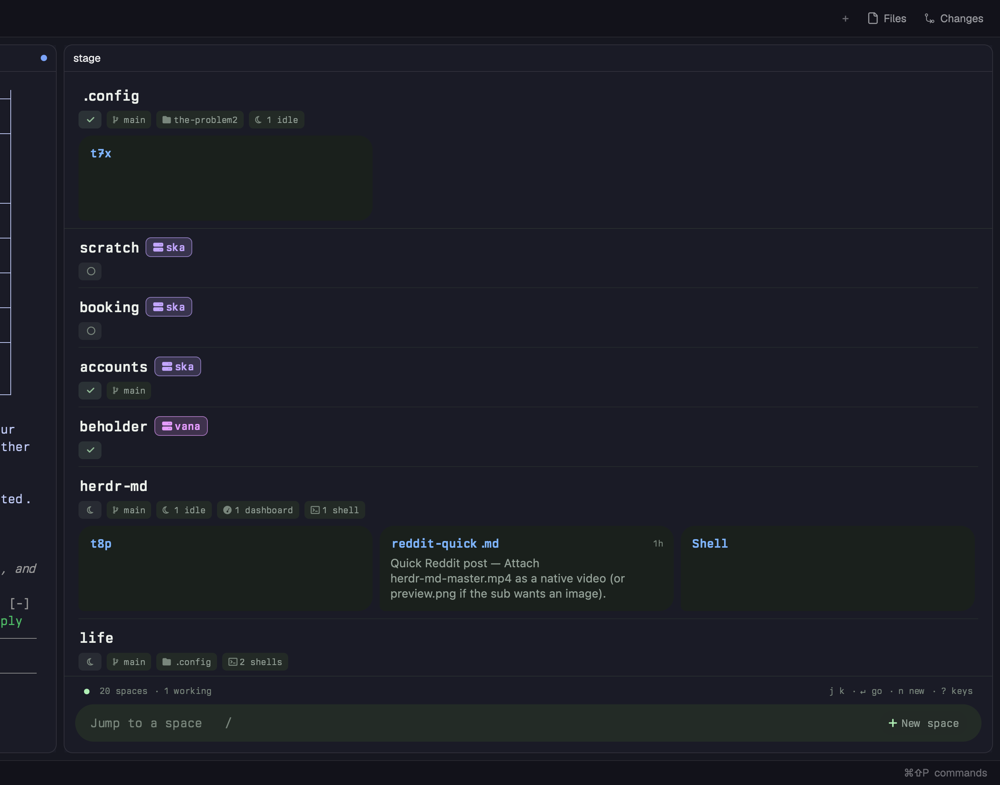
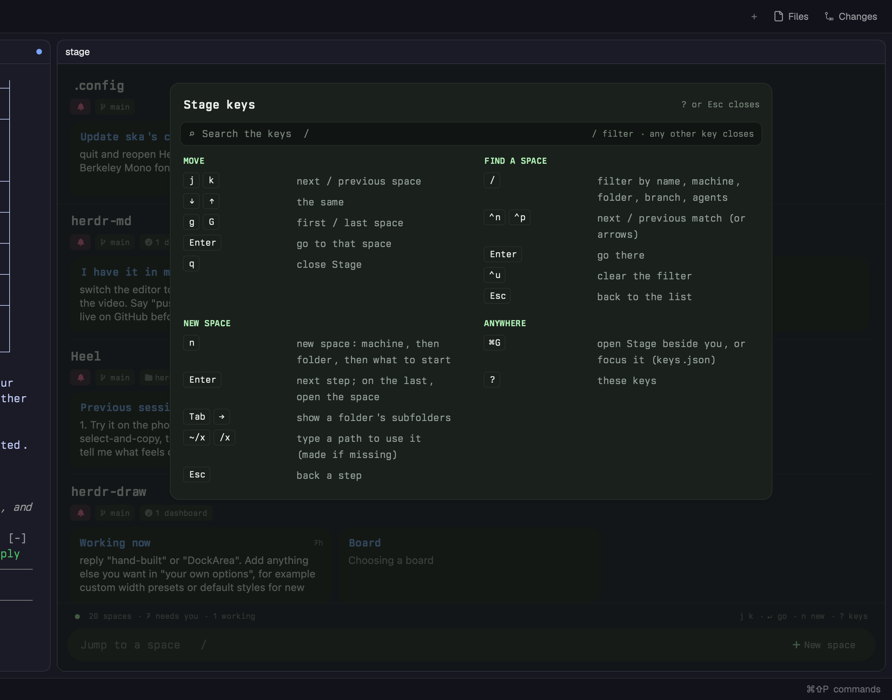
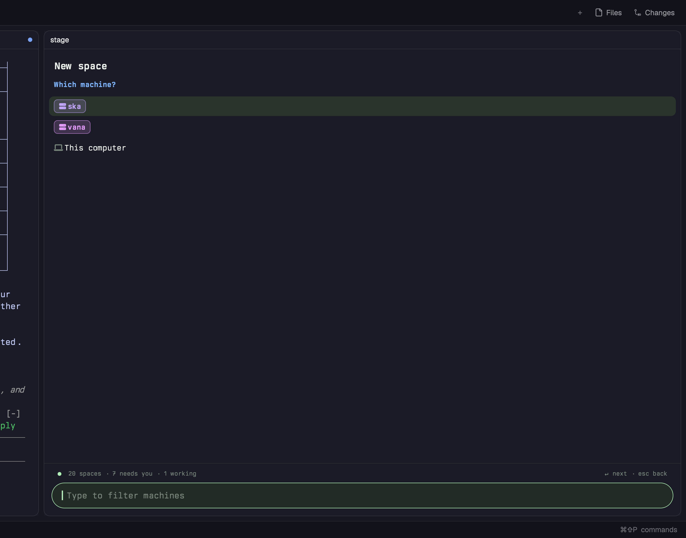
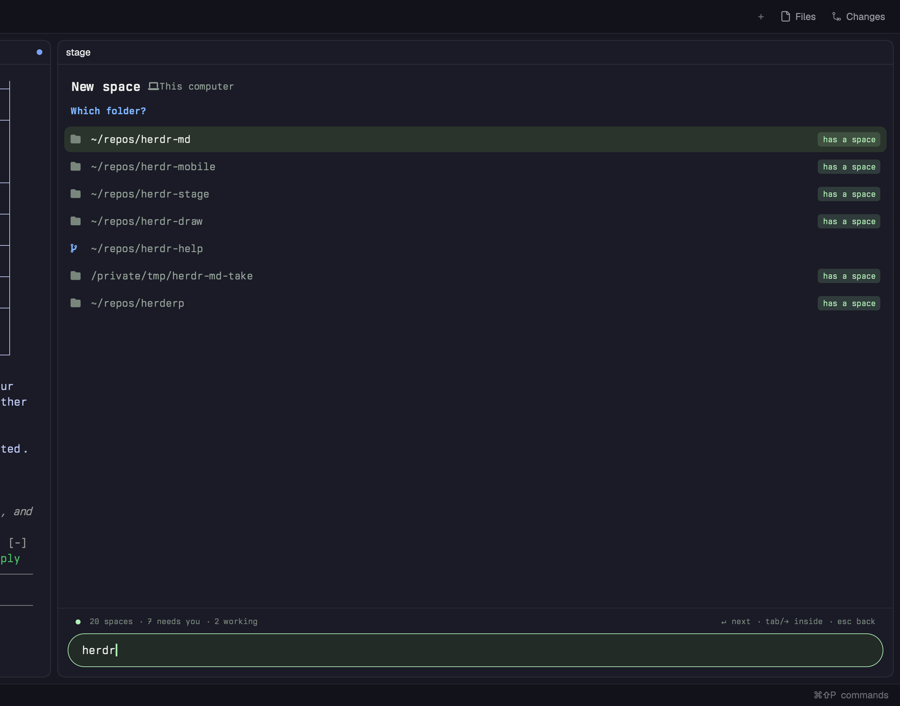
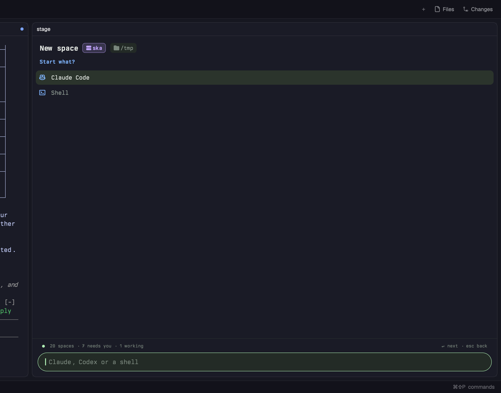

# herdr-stage

The stage for the Herdr desktop app: spaces as cards, what each agent needs from you, and a summary of
every agent that stops. Hexagonal: `core/` is plain JS with no Herdr, UI or Node imports; `adapters/` and
`mod/` are the hosts; skins only render the core's view-models.

- `core/` summary-on-idle rules and prompt, ask extraction (hand-offs like "#218 is waiting for you")
- `adapters/node.js` herdr-core, Claude session transcripts, the `claude` CLI summarizer, a JSON store
- `bin/summary-job.mjs` summarize agents when they go idle (`--once`, `--addr tX`); cache at
  `~/.cache/herdr-stage/summaries.json`
- `bin/eval-summary.mjs` run the ask fixtures through the real model (spends quota; run by hand)
- `core/stage.js`, `core/nav.js` the stage view-model and its keyboard behaviour (pure, tested)
- `mod/` the Herdr skin: `adapter.js` (Herdr data, git, transcripts, summary cache), `themes.js` (colour and font
  tokens: default and neon noir, `t` switches) and `main.js` (drawing; canvas zoom `+` `-` `0` or cmd-scroll, scroll pans);
  `scripts/install.sh` copies it plus `core/` into `~/.config/herdr-app/mods/stage`. Opens with cmd-g as a pane,
  or docks: a layout block `{"mod": "stage", "props": {"dock": true}}` keeps it up across tabs and spaces (the
  matrix layout has one, `stage-dock`). Docked it never takes the keyboard by itself; `pane.go` (cmd-l) moves in,
  and Enter or Esc hands the keyboard back to the space's terminal.
- `npm test` unit tests (no model calls)

Mods share one script engine, and one mod running out of memory breaks every mod until Herdr restarts,
so the adapter reads small transcript tails, one at a time, only for agents that have stopped.

## Screens (2026-11-09)

| | |
|---|---|
|  |  |
| Each space: its machine (remote ones only), status, branch, folder and counts as chips. | `?`: Stage's keys, from the herdr-help package. |
|  |  |
| `n`: pick a machine… | …a folder on it (repos found there; your spaces' folders first)… |
|  | |
| …and what to start. | |

- `n` new space: `core/open.js` (machine, folder, program; tested) and the scan it runs on the machine.
  A `~` folder is expanded on that machine; if no space appears within 5 s the status line says so.
- Machine tabs (All · This Mac · each remote): Tab / Shift-Tab or click; each tab counts the spaces that
  need you, the choice is remembered, and `/` still searches every machine. Hidden when every space is on
  one machine. `core/machines.js` (tested).
- Agent details for a remote space (title, last message) are read on that machine, like its git status.
- The space you're in has its own section at the top (sky blue, "you're here"), on every machine tab and while
  searching; the list below leaves it out.
- `?` key list: copied in from [herdr-help](https://github.com/ryanthedev/herdr-help) (`~/repos/herdr-help`) by its `sync.sh` into `mod/help/`.

## Nesting a space under another

Label any terminal in the child space; Stage draws the parent and its children as one family: a shared
mint-outlined panel, and a rail from the parent's status chip to a dot at each child's name
(`familyMarks` in `core/nest.js`, tested; `NEST` in `mod/main.js` picks rail, panel or both):

```sh
hc label <terminal> stage.parent=<parent space name or id>    # e.g. hc label vana/t9 stage.parent=devops
```

Works for spaces on other machines too. A parent given by name is looked for on the child's machine first.
"Parent" here is only this label: it doesn't change the space's folder.
